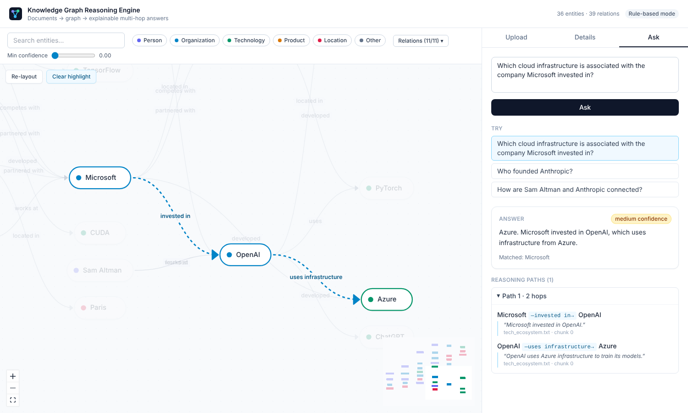

# 🕸️ Knowledge Graph Construction & Reasoning Engine

[](https://knowledge-graph-construction-and-re.vercel.app/)
[](https://knowledge-graph-construction-and.onrender.com/api/health)
[](https://www.python.org/)
[](https://fastapi.tiangolo.com/)
[](https://react.dev/)
[](https://www.typescriptlang.org/)
[](https://www.docker.com/)

> An end-to-end neuro-symbolic engine that transforms unstructured text and PDFs into structured knowledge graphs, visualizes complex networks interactively, and answers natural language questions via multi-hop traversal with complete evidence provenance.

---

### 🌐 Live Deployments

- **Interactive Web Application**: [https://knowledge-graph-construction-and-re.vercel.app/](https://knowledge-graph-construction-and-re.vercel.app/)
- **Backend API & Swagger Docs**: [https://knowledge-graph-construction-and.onrender.com/docs](https://knowledge-graph-construction-and.onrender.com/docs)
- **API Health Check**: [https://knowledge-graph-construction-and.onrender.com/api/health](https://knowledge-graph-construction-and.onrender.com/api/health)

---

## 📸 Demo Preview



*The canonical query: **"Which cloud infrastructure is associated with the company Microsoft invested in?"** resolved via `Microsoft —invested_in→ OpenAI —uses_infrastructure→ Azure` with full sentence attribution and canvas path highlighting.*

---

## ⚡ Key Capabilities

- **📄 Robust Document Ingestion**: Ingests PDFs and raw text files using PyMuPDF (`fitz`), with smart page-splitting, unicode cleaning, and chunk overlap.
- **🧠 Dual-Mode Relation Extraction**:
  - **Deterministic Rule Engine (Offline)**: spaCy dependency parsing with grammar rules and controlled relationship schemas. Requires **zero API keys**.
  - **LLM Augmented (Gemini 2.5 Flash)**: Contextual extraction with grounded entity validation and hallucination filters.
- **🔗 Intelligent Entity Resolution**: Normalizes corporate suffixes, merges aliases (e.g., *"Sam Altman"* $\leftrightarrow$ *"Altman"*), and performs token-based fuzzy matching.
- **🕸️ Interactive Visualization**: Built on React Flow (`@xyflow/react`) with Dagre hierarchical graph layouts, real-time node filtering, type badges, and degree statistics.
- **🔍 Explainable Multi-Hop Reasoning**:
  - Traverses the NetworkX knowledge graph using directed and undirected BFS / shortest-path algorithms.
  - Returns step-by-step reasoning paths where **every single hop** quotes the exact source sentence and originating document.
  - If no supporting path exists, the engine explicitly rejects false conclusions rather than hallucinating.

---

## 🏗️ Architecture Pipeline

```text
┌─────────────────┐       ┌────────────────────┐       ┌────────────────────┐
│   Upload PDF/TXT│ ───▶  │ Text Clean & Chunk │ ───▶  │  spaCy NER Engine  │
└─────────────────┘       └────────────────────┘       └────────────────────┘
                                                                  │
                                                                  ▼
┌─────────────────┐       ┌────────────────────┐       ┌────────────────────┐
│ React Flow UI   │ ◀───  │ NetworkX + SQLite  │ ◀───  │ Entity Resolution  │
│ Interactive Map │       │ Persistence Store  │       │ & Alias Linking    │
└─────────────────┘       └────────────────────┘       └────────────────────┘
        │                                                         ▲
        ▼                                                         │
┌─────────────────┐       ┌────────────────────┐       ┌────────────────────┐
│ Natural Language│ ───▶  │ Entity Linking &   │ ───▶  │ Multi-Hop BFS /    │
│ User Question   │       │ Pattern Detection  │       │ Path Traversal     │
└─────────────────┘       └────────────────────┘       └────────────────────┘
```

---

## 🚀 Quick Start

### Option 1: Docker Compose (Recommended)

Run the entire stack (Frontend + Backend + SQLite + Reverse Proxy) with a single command:

```bash
# 1. Clone repository
git clone https://github.com/SakshamKriplani/Knowledge-Graph-Construction-and-Reasoning-Engine.git
cd Knowledge-Graph-Construction-and-Reasoning-Engine

# 2. (Optional) Set up Gemini API key in .env
copy .env.example .env    # Linux/Mac: cp .env.example .env

# 3. Build & start containers
docker-compose up --build
```

- **Frontend**: [http://localhost:5173](http://localhost:5173)
- **API Swagger Docs**: [http://localhost:8000/docs](http://localhost:8000/docs)

---

### Option 2: Local Development

#### Prerequisites
- **Python 3.10+** (Tested on Python 3.11.9)
- **Node.js 18+** & **npm**

#### 1. Backend Setup
```bash
cd backend
python -m venv venv
.\venv\Scripts\activate       # Linux/Mac: source venv/bin/activate
pip install -r requirements.txt
python -m spacy download en_core_web_sm
copy .env.example .env        # Linux/Mac: cp .env.example .env
uvicorn app.main:app --reload
```
*Backend runs on `http://localhost:8000`.*

#### 2. Frontend Setup (New Terminal)
```bash
cd frontend
npm install
copy .env.example .env        # Linux/Mac: cp .env.example .env
npm run dev
```
*Frontend runs on `http://localhost:5173`.*

---

## 🎯 Supported Question Patterns

| Pattern | Example Question | Resolution Method |
|---|---|---|
| **Direct Lookup** | *"Who founded OpenAI?"* / *"Where does Altman work?"* | 1-hop targeted relation match or directed path search |
| **Chained Multi-Hop** | *"Which cloud infrastructure is associated with the company Microsoft invested in?"* | Multi-hop BFS traversal: `Entity A → r1 → Entity B → r2 → Entity C` |
| **Entity Connection** | *"How are Sam Altman and Microsoft connected?"* | Bidirectional shortest paths across the graph (up to 4 hops) |
| **Exploratory Fallback**| *"Tell me about Nvidia"* | 2-hop neighborhood exploration with confidence estimation |
| **Unknown Entity** | *"What did QuantumCorp acquire?"* | Safe rejection notice when entities do not exist in the graph |

---

## 🛠️ REST API Reference

Interactive OpenAPI documentation is available at `/docs`.

| Method | Endpoint | Description |
|---|---|---|
| `POST` | `/api/documents` | Upload and process a PDF/TXT document (multipart) |
| `POST` | `/api/documents/sample` | Load and parse the pre-bundled AI ecosystem dataset |
| `GET` | `/api/documents` | List all processed documents |
| `POST` | `/api/graph/build` | Construct a knowledge graph from selected document IDs |
| `GET` | `/api/graph/{graph_id}` | Retrieve full graph topology (nodes, edges, statistics) |
| `GET` | `/api/graph/{graph_id}/entity/{id}` | Inspect incoming/outgoing relationships for a specific node |
| `GET` | `/api/graph/{graph_id}/search?q=` | Fuzzy entity search across canonical names and aliases |
| `GET` | `/api/graph/{graph_id}/export` | Export graph data in JSON format |
| `POST` | `/api/query` | Execute natural language multi-hop graph reasoning |
| `GET` | `/api/health` | Service health status and LLM configuration check |

---

## 🧪 Testing

The test suite runs completely offline with mocked LLM fallbacks:

```bash
cd backend
pytest
```

To run the sample extraction benchmark:
```bash
python -m scripts.extract_sample
```

---

## ⚙️ Configuration Reference

### Backend (`backend/.env`)

| Variable | Default | Description |
|---|---|---|
| `GEMINI_API_KEY` | *(empty)* | Optional. If omitted, engine runs in deterministic offline rule mode |
| `GEMINI_MODEL` | `gemini-2.5-flash` | Gemini model for relation extraction & phrasing |
| `DATABASE_URL` | `sqlite:///./kg.db` | SQLite database connection string |
| `ALLOWED_ORIGINS` | `http://localhost:5173` | Comma-separated list of allowed CORS origins |
| `MAX_UPLOAD_MB` | `10` | Maximum file upload size limit |
| `MAX_PAGES` | `50` | Maximum PDF page count limit |

### Frontend (`frontend/.env`)

| Variable | Default | Description |
|---|---|---|
| `VITE_API_URL` | `http://localhost:8000/api` | Base URL pointing to the backend API |

---

## 📁 Repository Structure

```text
├── backend/
│   ├── app/
│   │   ├── routers/       # FastAPI route handlers (documents, graph, query)
│   │   ├── services/      # Ingestion, NER, relation extraction, graph builder, reasoner
│   │   ├── config.py      # Pydantic v2 application settings
│   │   ├── db.py          # SQLite persistence layer and schema definitions
│   │   ├── main.py        # FastAPI entrypoint and CORS lifecycle
│   │   └── models.py      # Core data models and schemas
│   ├── data/              # Controlled vocabularies, seed entities & sample dataset
│   ├── tests/             # Pytest test suite
│   ├── Dockerfile         # Python 3.11 container definition
│   └── requirements.txt
├── frontend/
│   ├── src/
│   │   ├── api/           # Typed API client
│   │   ├── components/    # GraphCanvas, QueryPanel, UploadPanel, NodeDetailPanel
│   │   ├── lib/           # Dagre layout engine and styling utilities
│   │   ├── types.ts       # TypeScript schemas mirroring backend models
│   │   └── App.tsx        # Main application dashboard
│   ├── nginx.conf         # Production Nginx reverse-proxy configuration
│   ├── Dockerfile         # Multi-stage production container build
│   └── package.json
├── docker-compose.yml     # Multi-container orchestration
├── render.yaml            # Render backend deployment blueprint
├── plan.md                # System design & implementation specification
└── README.md
```

---

## 📄 License

This project is licensed under the [MIT License](LICENSE).
